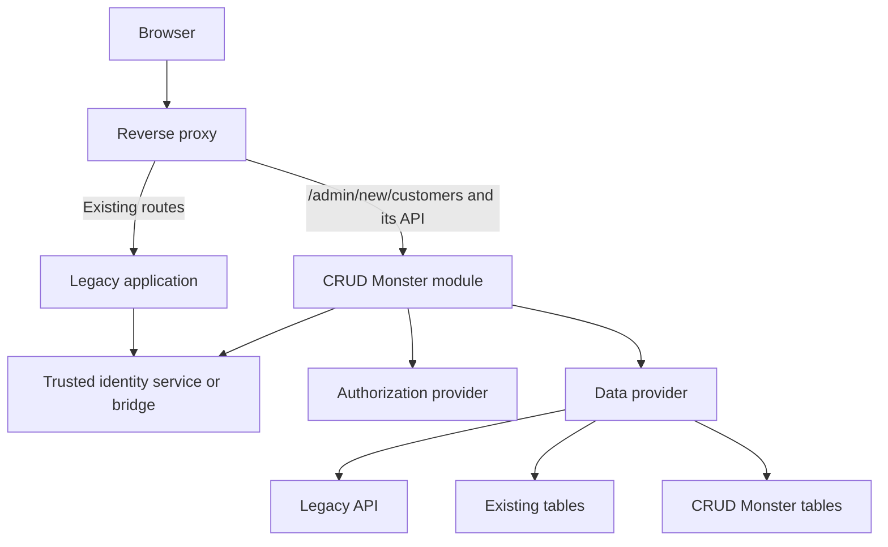

# Gradual migration from existing applications

Status: proposed architecture and roadmap. The provider contracts and integration
features described here are design goals, not currently supported generator APIs.

CRUD Monster should let a team replace an existing application one module at a
time. For example, a PHP application can keep handling orders while a generated
backend takes over customer administration. This follows the Strangler Fig
approach: each migrated module has a clear boundary and can be routed back to the
original application if needed.

## Deployment model

The default proposal is two independent services behind one reverse proxy. The
legacy application and CRUD Monster share a trusted identity source; users sign
in once. A shared database is optional.

Mounting includes the UI, API base path and authentication callback paths. React
UI can use CRUD Monster React, while existing PHP pages can also consume the API
directly. UI embedding is an optional presentation choice; backend services retain
their own deployment and authorization boundaries.

## Integration contracts

Define these responsibilities independently of the generated backend language.
TypeScript, Rust and Go implementations should share their semantics rather than
require identical language-level interfaces.

| Contract | Responsibility |
| --- | --- |
| `IdentityProvider` | Authenticate a request and return a verified identity or an unauthenticated result. |
| `AuthorizationProvider` | Decide whether an identity can perform an action on a resource, including record-level restrictions. |
| `DataProvider` | Read and write model data through an owned database, an existing table or an external API. |
| `ModuleRegistry` | Register model providers, supported operations and route prefixes; reject conflicting routes. |

An identity needs a stable provider identifier and subject, with optional email,
roles and permissions. Map identities by `(provider, subject)`, for example
`(legacy-php, 123)`, so unrelated providers cannot collide. Email is an attribute,
not an account-linking key. External identities must not require copying passwords
or creating a second locally managed account.

Authentication establishes who the caller is. Authorization may be owned by CRUD
Monster or delegated to the legacy system independently. Every API operation must
enforce permissions, including record-level checks and constraints on list queries.
Hiding a UI action does not enforce access control. Provider failures must deny
access rather than fall back to a public identity or local login.

## Connecting an existing login

Support these integration paths:

| Path | How identity is established | Intended use |
| --- | --- | --- |
| Session bridge | A trusted server-side endpoint validates the existing application's session and returns identity. | Initial integration with minimal legacy changes. |
| Token bridge | A trusted issuer verifies the legacy login and issues a short-lived signed credential for CRUD Monster. | Separate services while retaining the legacy login. |
| OIDC | Both applications use a common identity provider. | Long-term shared sign-in and independent application lifecycles. |

For an initial PHP integration without OIDC, the proposed starting point is the
token bridge. Its design must define trusted issuers, intended audience, signature
verification, expiry, key rotation and replay protection appropriate to the chosen
flow. A browser-supplied user ID or identity header alone is never proof of login.
If a proxy supplies identity, it must remove incoming identity headers and prevent
clients from bypassing the trusted proxy.

The integration must also define logout and permission-change behavior. Clearing
the PHP session alone does not invalidate an already issued token. Choose and
document a revocation or session-check mechanism and any bounded cache lifetime;
make the maximum delay before access is removed explicit. Cookie-based flows need
CSRF protection and deliberate cookie scope, and callback or return URLs must be
restricted to approved destinations.

## Data ownership

| Model mode | Data access | Schema and migration ownership |
| --- | --- | --- |
| Native | CRUD Monster-managed database tables. | CRUD Monster owns the schema and migrations. |
| External | Legacy API or another service adapter. | The external system owns storage and business rules. |
| Adopted | Adapter over existing database tables. | The existing system retains schema ownership until an explicit handover. |

An adopted model needs explicit connection, table, column and primary-key mapping,
plus a list of supported operations. Start with read-only access where possible.
Do not generate migrations for adopted tables unless ownership is explicitly
transferred. Each write operation must have an agreed owner during coexistence.

Direct writes to legacy tables can bypass validation, events and other business
rules. Use an API adapter when those rules belong to the legacy application.
Provider capabilities must be explicit: unsupported filtering, pagination or writes
should fail clearly rather than silently change behavior. Cross-provider relations
and multi-service transactions need separate designs; a generated CRUD operation
must not imply atomic writes across independent systems.

## First integration milestone

Deliver one customer-administration module alongside a PHP application:

1. Add external identity authentication and stable provider/subject mapping.
2. Enforce authorization before every operation, including access to individual records.
3. Connect one external data provider; enable writes only through the agreed owner.
4. Mount the module and its API under a configurable route prefix.
5. Verify the integration with end-to-end tests before moving traffic to it.

Acceptance tests should cover invalid and expired credentials, logout, identity
collisions, permission changes, access to another user's data, scoped list queries,
provider outages and direct API requests that bypass the UI. Verify that disabled
operations cannot be called and regeneration preserves the custom adapters.

## Migration sequence

1. **Integrate:** retain the legacy login and move one small module behind the shared proxy.
2. **Expand:** add modules with explicit identity, permission and data ownership boundaries.
3. **Transfer ownership:** move selected business rules and data with a reviewed migration and reconciliation plan. Avoid uncoordinated dual writes.
4. **Retire:** remove legacy routes only after the replacement has been verified in production.

Each routing change needs a rollback plan. Once the replacement writes data the
legacy application cannot understand, routing traffic back requires a compatible
data recovery or synchronization plan as well.
